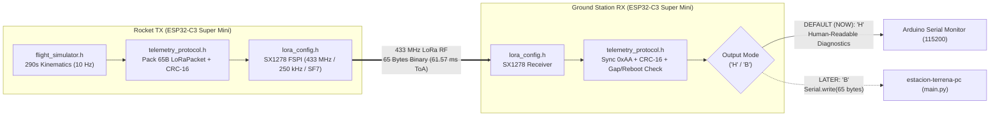

# estacion-terrena-esp32

ESP32-C3 Super Mini + XL1278-SMT (SX1278 433 MHz) telemetry firmware for the **Experimental Rocket V2** (**Invenciones Espaciales / ENTUSIASMO**), implementing both the Rocket Transmitter (`TransmisorCohete`) and Ground Station Receiver (`EscuchaTramaEstacionTerrena`) aligned with the 65-byte Little-Endian binary frame specification in [`estacion-terrena-pc`](https://github.com/Invenciones-Espaciales/estacion-terrena-pc).

---

## 1. Repository Structure

```text
estacion-terrena-esp32/
├── include/
│   ├── telemetry_protocol.h        # Shared 65-byte LoRaPacket struct, CRC-16/CCITT-FALSE, flight labels
│   └── lora_config.h               # ESP32-C3 FSPI pins, brownout helper, 433 MHz / 250 kHz / SF7 setup
├── TransmisorCohete/               # Annex A: Rocket TX (290s 10 Hz Flight Simulator over LoRa)
│   ├── TransmisorCohete.ino
│   ├── flight_simulator.h
│   ├── lora_config.h
│   └── telemetry_protocol.h
├── EscuchaTramaEstacionTerrena/    # Annex B: Ground Station RX (Human-Readable + Raw Binary Bridge)
│   ├── EscuchaTramaEstacionTerrena.ino
│   ├── lora_config.h
│   └── telemetry_protocol.h
└── tests/
    └── verify_protocol.cpp         # Host C++17 offset, CRC-16, and simulation parity verification
```

*(Headers are mirrored inside each sketch directory so both sketches compile directly inside the Arduino IDE with zero external library path setup.)*

---

## 2. System Architecture



---

## 3. Hardware Wiring (ESP32-C3 Super Mini & XL1278-SMT)

> [!CAUTION]
> **Never use GPIOs 12–17 on the ESP32-C3** (they are wired internally to SPI Flash memory and will crash/reboot the MCU immediately), and **power the XL1278-SMT strictly from 3.3V** (never 5V).

| Signal | ESP32-C3 Pin | XL1278-SMT Function | Notes |
| :--- | :---: | :--- | :--- |
| **SCK** | `GPIO 4` | `SCLK` | Native FSPI clock |
| **MISO** | `GPIO 5` | `MISO` | Native FSPI MISO |
| **MOSI** | `GPIO 6` | `MOSI` | Native FSPI MOSI |
| **CS / NSS** | `GPIO 7` | `NSS` | Chip Select (Active Low) |
| **RST** | `GPIO 10` | `RESET` | Optional; set `PIN_LORA_RST = -1` if left disconnected |
| **DIO0** | `GPIO 3` | `DIO0` | Rx/Tx Done interrupt |
| **VCC** | `3.3V` | `VCC` | Add a 220–470 uF capacitor across 3.3V/GND for >2 dBm TX |
| **GND** | `GND` | `GND` | Common ground |

### Power Stability Note
`LORA_TX_POWER_DBM` in `lora_config.h` defaults to **`2` dBm** for safe USB bench testing without collapsing the ESP32-C3 Super Mini's small 3.3V regulator. Before outdoor flight testing, install a **220–470 uF** bulk decoupling capacitor (or dedicated 3.3V LDO >= 500 mA) on the radio's VCC rail and raise `LORA_TX_POWER_DBM` to `17` (or `20`).

---

## 4. Flashing & Usage

### Arduino IDE Settings (ESP32-C3 Super Mini)
- **Board:** `ESP32C3 Dev Module`
- **USB CDC On Boot:** **`Enabled`** *(Required so `Serial` outputs over USB-C)*
- **Library Required:** `LoRa` by Sandeep Mistry

### `arduino-cli` Commands
```bash
# Flash Rocket Transmitter
arduino-cli compile -b esp32:esp32:esp32c3:CDCOnBoot=cdc -u -p /dev/ttyACM0 TransmisorCohete

# Flash Ground Station Receiver
arduino-cli compile -b esp32:esp32:esp32c3:CDCOnBoot=cdc -u -p /dev/ttyACM1 EscuchaTramaEstacionTerrena
```

### Switching Receiver Output Modes
Open the Serial Monitor at **`115200` baud**:
- **Human-Readable Mode (Default):** Prints 10 Hz decoded packet lines plus a 1 Hz RF and sensor diagnostics summary (`RSSI`, `SNR`, `Packet Loss %`, `CRC Errors`, altitude, IMU, GPS, pyro pins).
- **Raw Binary Mode (for `estacion-terrena-pc/main.py`):** Send **`B`** over Serial (or set `DEFAULT_HUMAN_READABLE_MODE = false` in `EscuchaTramaEstacionTerrena.ino` and re-flash) to stream raw 65-byte frames via `Serial.write()`. Send **`H`** to switch back to Human-Readable Mode.

---

## 5. Verification

Run the host C++17 protocol and simulation verification suite:
```bash
g++ -std=c++17 -Wall -Wextra -Werror -Iinclude -ITransmisorCohete tests/verify_protocol.cpp -o /tmp/verify_protocol && /tmp/verify_protocol
```

---

## 6. Reference Text for Design Document — Section 2.5 (Interfaces & Information Flow)

Below is the technical specification draft for **Section 2.5 ("Interfaces y Flujo de Información")** of the COMMS Technical Design Document:

> The onboard avionics (OBC) acquires physical flight variables from three digital sensor buses and routes them through deterministic memory packing to the RF telemetry stage:
>
> 1. **Sensor Acquisition Layer:**
>    - **I2C Bus:** Polls the BMP280 barometer (static pressure and temperature) and the 6-DoF IMU (tri-axial linear acceleration and angular rates).
>    - **UART Serial Interface:** Parses NMEA position, altitude (ASL), ground speed, and satellite fix counts from the GNSS/GPS receiver.
>    - **Digital GPIO Actuators:** Samples the logic states (`0`/`1`) of the drogue (`pin_frenado`) and main parachute (`pin_principal`) pyrotechnic firing channels.
> 2. **Framing & Integrity Layer:** At a fixed 10 Hz (`100 ms`) cadence, the ESP32-C3 packs all 20 telemetry channels into a 65-byte Little-Endian `__attribute__((packed))` structure prefixed by `0xAA`, stamps the rolling `frame_number` and `millis()` timestamp, and appends a 16-bit `CRC-16/CCITT-FALSE` checksum computed over bytes `0..62`.
> 3. **RF Transport Layer (FSPI):** The OBC transfers the 65-byte frame over the native ESP32-C3 FSPI bus (`SCK=GPIO4`, `MISO=GPIO5`, `MOSI=GPIO6`, `CS=GPIO7`, `RST=GPIO10`, `DIO0=GPIO3`) to the XL1278-SMT (`SX1278`) transceiver operating at `433 MHz`, `250 kHz` bandwidth, `SF7`, and `CR 4/5` (`61.57 ms` Time on Air).
> 4. **Ground Station Demodulation & PC Bridge:** The ground ESP32-C3 + XL1278-SMT unit receives the 65-byte RF frame, verifies length, `0xAA` sync header, and `CRC-16/CCITT-FALSE` integrity, and forwards either human-readable diagnostics (bench testing) or the raw 65-byte binary stream (flight operations) over USB CDC (`115200` baud) to the Ground Station PC (`estacion-terrena-pc/main.py`).
